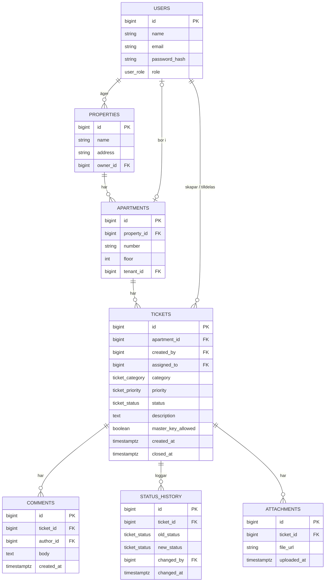

# Databasschema

Utgår från Must-stories i [user stories](user-stories.md). Tabellerna skapas av Flyway: [`V1__init.sql`](../backend/src/main/resources/db/migration/V1__init.sql). Större ändringar skrivs också in i [beslutsloggen](beslutslogg.md).

## Diagram

Samma diagram som bild, med fler detaljer (unika kolumner, standardvärden och kommentarer): [`bilder/databasschema.png`](bilder/databasschema.png). Källan finns i [`bilder/databasschema.mmd`](bilder/databasschema.mmd). Bilden har också kolumnen `room` i `tickets`, markerad "ny i V2". Den finns inte i `V1__init.sql` än, och det är inte bestämt om rummet ska vara fritt textfält eller en fast lista (öppen fråga 6 i [frontendplanen](frontend-plan.md)).

## Tabeller

| Tabell | Innehåll |
|---|---|
| `users` | En användare med e-post, lösenord (hashat) och roll. |
| `properties` | En fastighet med namn och adress. Ägs av en förvaltare. |
| `apartments` | En lägenhet i en fastighet. Numret är unikt inom fastigheten. Kan ha en hyresgäst. |
| `tickets` | En felanmälan för en lägenhet: kategori, prioritet, status, beskrivning och om huvudnyckel får användas. |
| `comments` | En kommentar på ett ärende (Should). |
| `status_history` | Varje statusändring: från vilken status, till vilken, vem och när. Ger ärendets tidslinje. |
| `attachments` | En bild som bifogats ett ärende (Should). |

## Enums

Värdena är samma i databasen, backend och frontend ([frontendplanen](frontend-plan.md#typer-första-utkast-följer-databasschemat)).

| Enum | Värden |
|---|---|
| `user_role` | `TENANT`, `TECHNICIAN`, `MANAGER` |
| `ticket_status` | `NEW`, `ASSIGNED`, `IN_PROGRESS`, `WAITING`, `RESOLVED`, `CLOSED` |
| `ticket_category` | `PLUMBING`, `ELECTRICAL`, `APPLIANCES`, `VENTILATION`, `LOCKS_DOORS`, `OTHER` |
| `ticket_priority` | `URGENT`, `HIGH`, `NORMAL`, `LOW` |

## Testdata

[`db/testdata.sql`](../db/testdata.sql) fyller alla tabeller med testdata som följer schemat: användare i alla roller, fastigheter, lägenheter, ärenden i alla statusar med statushistorik och kommentarer. Hur man läser in den står i README, avsnittet "Testdata". Ändras schemat ska filen uppdateras i samma PR.

## Ändringar

| Datum | Ändring |
|---|---|
| 2026-10-21 | La till diagrammet som bild (`bilder/databasschema.png` och `.mmd`) |
| 2026-10-26 | La till avsnittet Testdata (`db/testdata.sql`) |
