# Frontendplan för MVP — Felanmälan

Utgår från [projektförslaget](projektforslag.md). Beskriver hur frontend (React + TypeScript) byggs upp och i vilken ordning. Backend (Spring Boot + PostgreSQL) finns i `backend/` i samma repo.

## Mål för MVP (frontend)

Allt under **Måste** i MoSCoW-listan ska gå att demonstrera i webbläsaren:

1. Logga in och hamna i rätt vy beroende på roll.
2. Förvaltaren hanterar fastigheter och lägenheter.
3. Hyresgästen skapar en felanmälan.
4. Varje roll ser sin lista med ärenden.
5. Förvaltaren tilldelar en tekniker.
6. Teknikern ändrar status och historiken visas.

## Vyer per roll

| Vy | Route | Hyresgäst | Tekniker | Förvaltare | Sprint |
|----|-------|:---------:|:--------:|:----------:|:------:|
| Inloggning | `/login` | ✓ | ✓ | ✓ | 1 |
| Ärendelista | `/tickets` | Mina ärenden | Tilldelade till mig | Alla öppna | 2 |
| Ny felanmälan | `/tickets/new` | ✓ | | | 2 |
| Ärendedetalj + historik | `/tickets/:id` | Läsa | Ändra status | Tilldela, stänga | 2–3 |
| Fastigheter | `/properties` | | | ✓ | 1 |
| Fastighet + lägenheter | `/properties/:id` | | | ✓ | 1 |
| Översikt | `/dashboard` | | | ✓ | 5 (Bör) |

Routes och kod skrivs på engelska, all text i gränssnittet på svenska.

## Formulär: ny felanmälan

| Fält | Typ | Regel |
|------|-----|-------|
| Kategori | Val | Obligatorisk: VVS, El, Vitvaror, Ventilation, Lås och dörrar, Övrigt |
| Rum | Text/val | Obligatorisk |
| Beskrivning | Textområde | Obligatorisk, tydligt felmeddelande om den saknas |
| Huvudnyckel får användas | Ja/Nej | Obligatorisk, inget förval |

Lägenhet hämtas från den inloggade hyresgästen. Prioritet sätts av förvaltaren (Kan-funktion med SLA).

Alla formulär byggs med React Hook Form och valideras med ett Zod-schema (se [beslutslogg #6](beslutslogg.md)).

## Statusflöde i gränssnittet

```
Ny → Tilldelad → Pågår ⇄ Väntar → Åtgärdad → Stängd
```

| Övergång | Vem | Hur |
|----------|-----|-----|
| Ny → Tilldelad | Förvaltare | Automatiskt när en tekniker tilldelas |
| Tilldelad → Pågår | Tekniker | Statusknapp |
| Pågår ⇄ Väntar | Tekniker | Statusknapp |
| Pågår → Åtgärdad | Tekniker | Statusknapp |
| Åtgärdad → Stängd | Förvaltare | Statusknapp |

Gränssnittet visar bara de knappar som rollen får använda. Backend måste ändå kontrollera behörigheten.

## Wireframes och mockups

Det här är **utkast** som gruppen ska rösta om. De ligger i [`bilder/mockups/utkast/`](bilder/mockups/utkast/). När gruppen har bestämt sig läggs de slutliga versionerna i [`bilder/mockups/slutliga/`](bilder/mockups/slutliga/), och då visar det här avsnittet dem i stället. Omröstningen och resultatet står i [omrostning-mockups.md](omrostning-mockups.md).

 **Wireframes** visar struktur och flöde, i grått. **Mockups** visar hur appen ska se ut. Mobilvyerna är 390 px breda, förvaltarens vy är för datorn. Datan kommer från [`db/testdata.sql`](../db/testdata.sql).

| Vy | Wireframe | Mockup |
|---|---|---|
| Logga in | 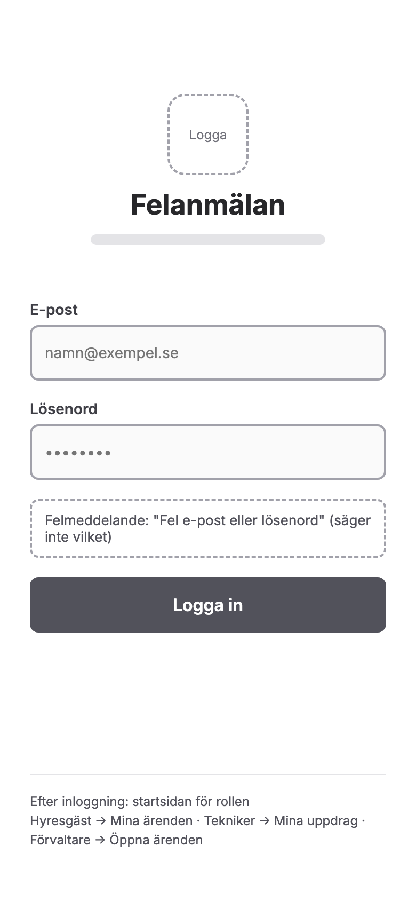 | 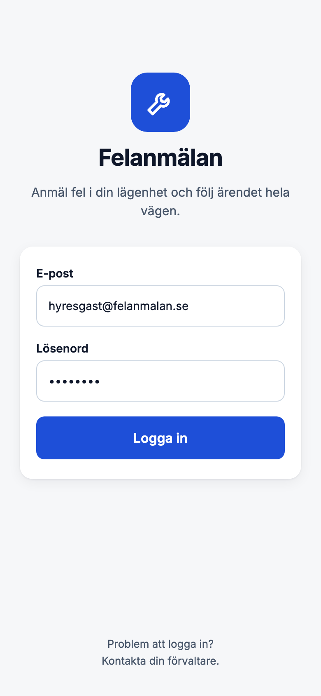 |
| Mina ärenden (hyresgäst) | 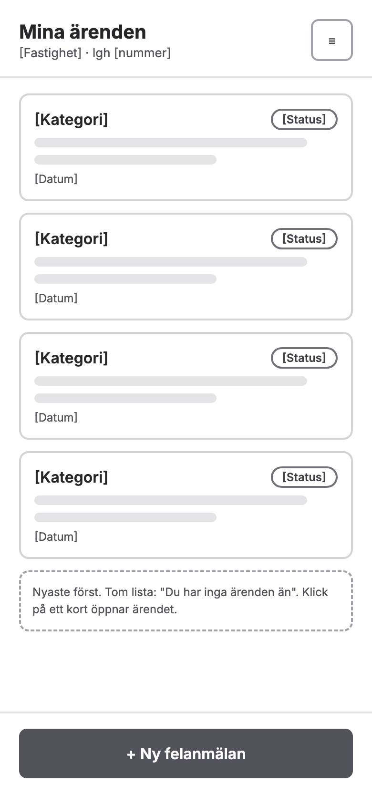 | 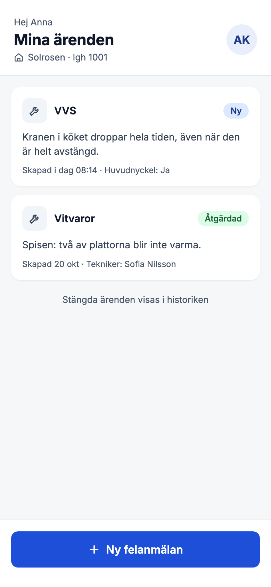 |
| Ny felanmälan | 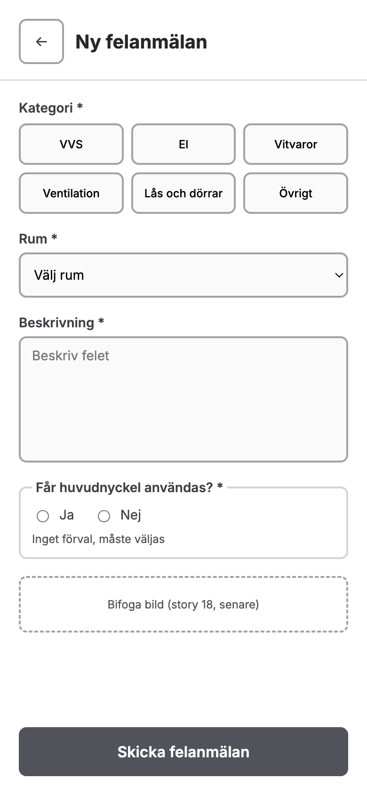 | 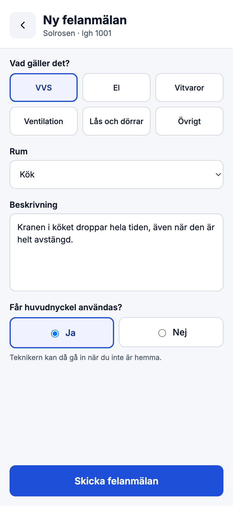 |
| Ärende och historik | 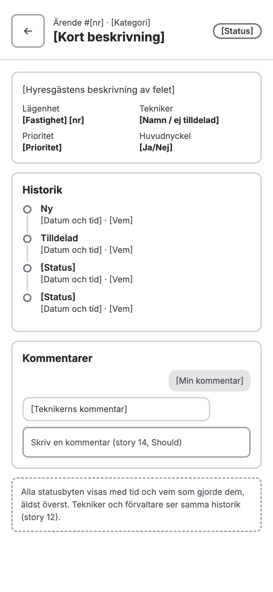 | 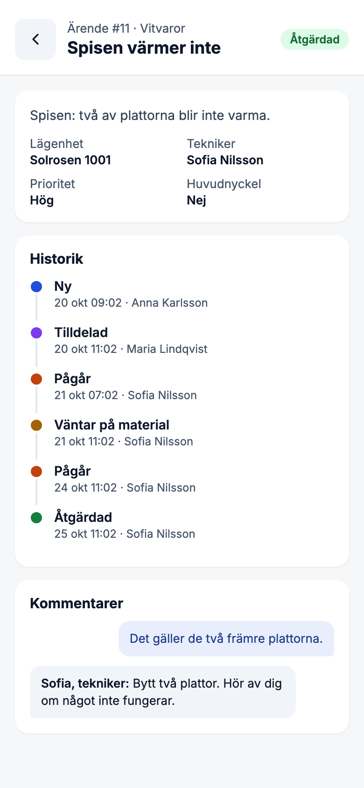 |

**Öppna ärenden (förvaltare)**

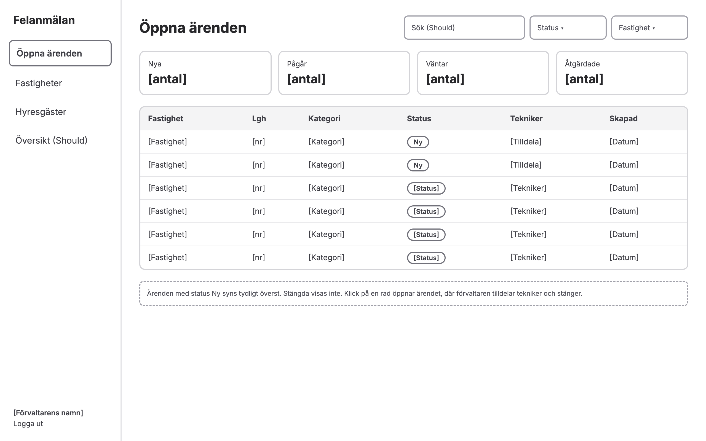

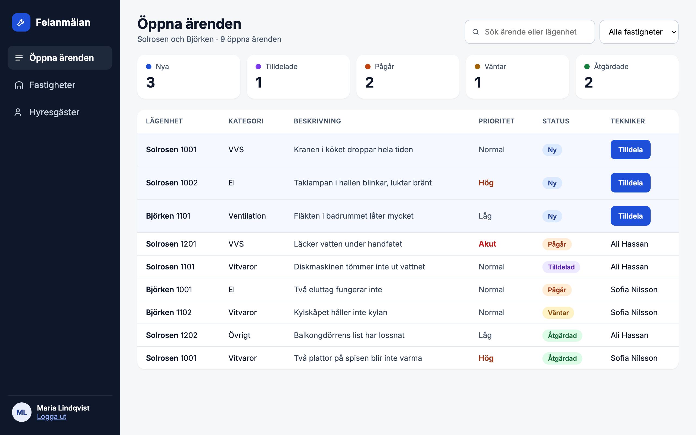

**Fastigheter (förvaltare, story 2)**

Listan över förvaltarens fastigheter och formuläret för en ny fastighet. Bilden visar felmeddelandet när adressen saknas.

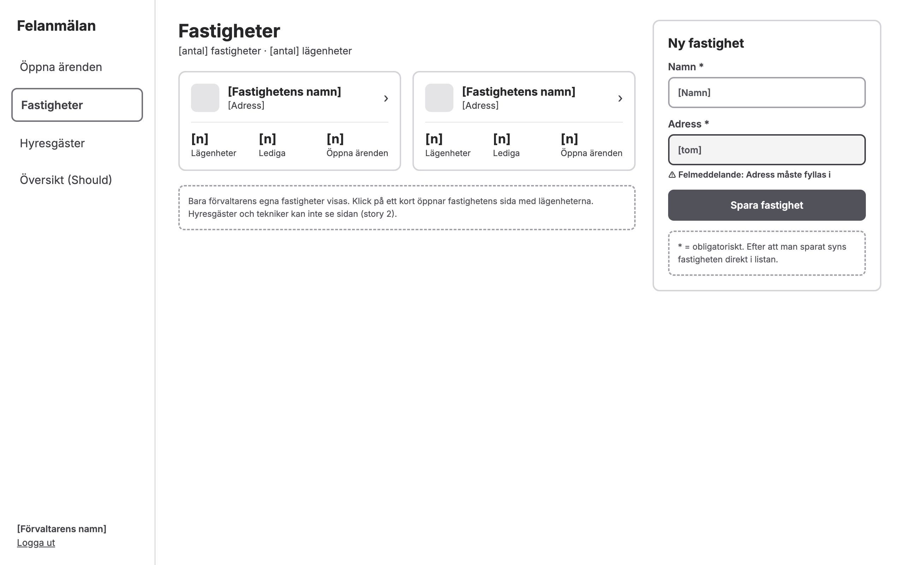

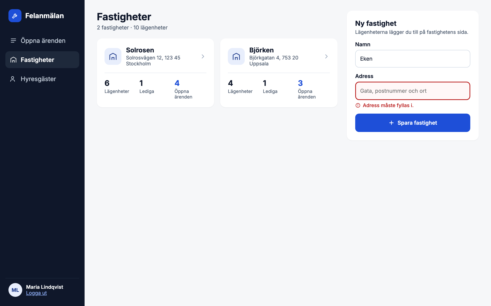

**Lägenheter i en fastighet (förvaltare, story 3 och 4)**

Fastighetens sida med lägenheterna och formuläret för en ny lägenhet. Bilden visar felmeddelandet när numret redan finns i fastigheten. En ledig lägenhet har knappen "Lägg till hyresgäst" (story 4).

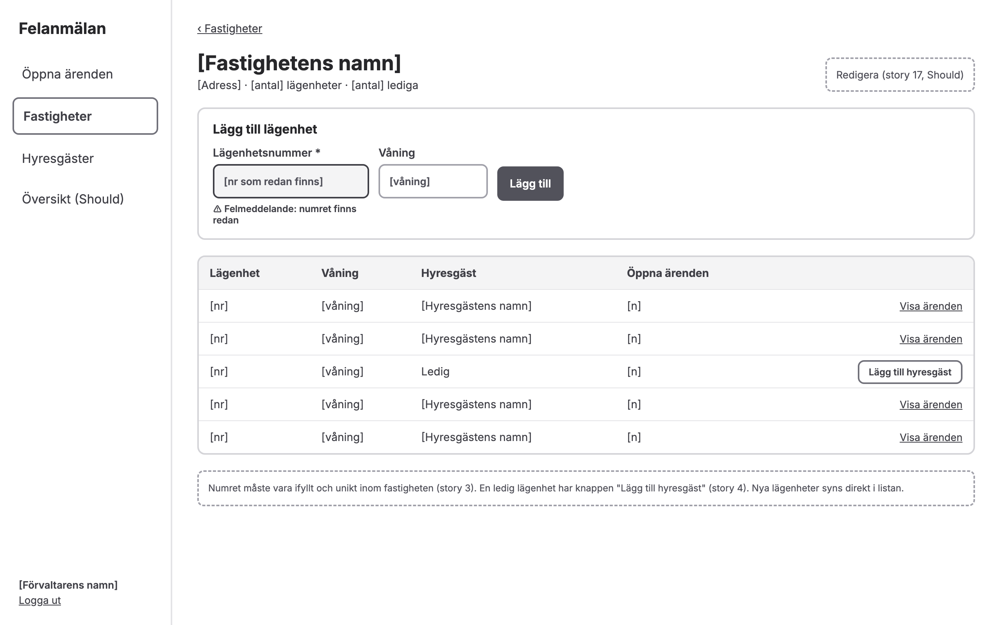

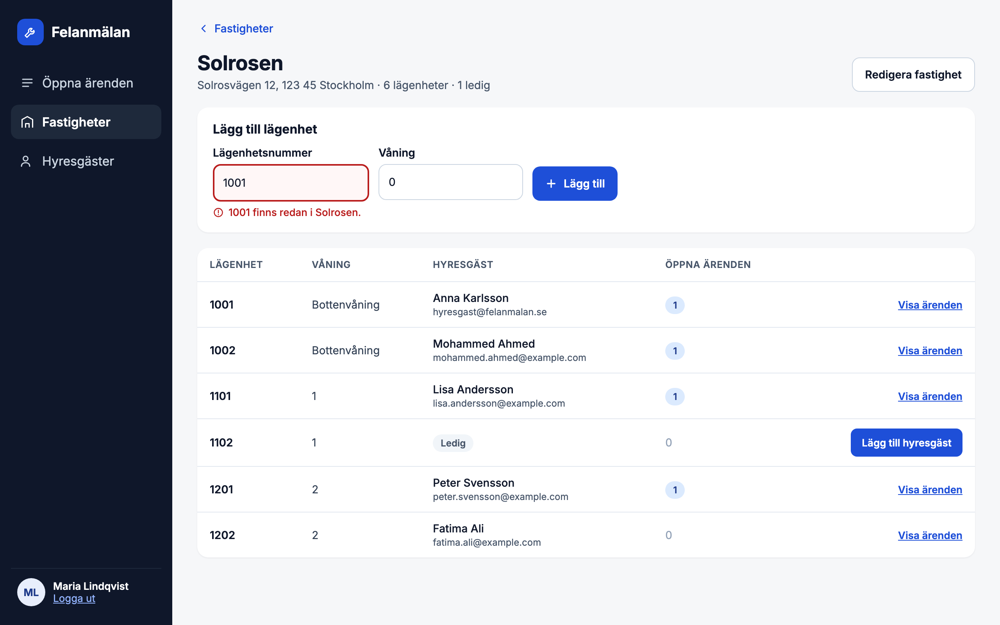

**Hyresgäster (förvaltare, story 4)**

Alla hyresgäster i förvaltarens fastigheter och formuläret för en ny hyresgäst. Bilden visar felmeddelandet när e-postadressen redan används. Lägenheter som redan har en hyresgäst är gråa och går inte att välja.

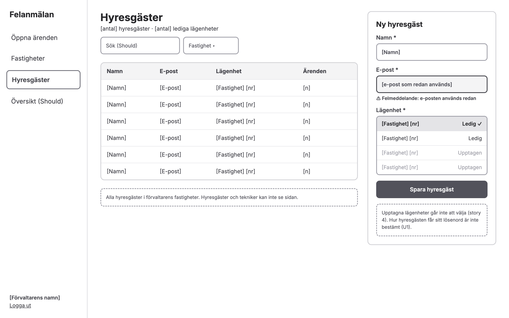

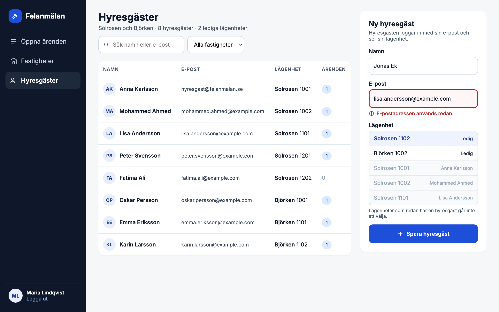

Statusfärger i mockuperna: Ny blå, Tilldelad lila, Pågår orange, Väntar gul, Åtgärdad grön, Stängd grå. Ljus bakgrund och mörk text, så att de går att läsa och skiljer sig åt i ljushet, inte bara i färg.

Att tänka på:

- Fältet **Rum** finns i formuläret (story 5) men inte i databasen än. Se öppen fråga 6.
- Historiken visar "Väntar på material". Om orsaken ska vara ett eget fält är öppen fråga 5.
- Hur hyresgästen får sitt lösenord är inte bestämt (öppet beslut 3 i U1). Mockupen för hyresgäster visar därför inget lösenordsfält.

## Mappstruktur

```
src/
  api/          # HTTP-klient, endpoints per resurs, mock-data
  auth/         # AuthContext, inloggning, skydd av routes per roll
  components/   # Delade komponenter: StatusBadge, Layout, Formulärfält
  features/
    tickets/    # Lista, formulär, detalj, historik
    properties/ # Fastigheter och lägenheter
  types/        # Delade typer (User, Ticket, Property …)
  App.tsx       # Routes
```

## Typer (första utkast, följer databasschemat)

```ts
type Role = 'TENANT' | 'TECHNICIAN' | 'MANAGER'
type TicketStatus = 'NEW' | 'ASSIGNED' | 'IN_PROGRESS' | 'WAITING' | 'RESOLVED' | 'CLOSED'
type Category = 'PLUMBING' | 'ELECTRICAL' | 'APPLIANCES' | 'VENTILATION' | 'LOCKS_DOORS' | 'OTHER'
type Priority = 'URGENT' | 'HIGH' | 'NORMAL' | 'LOW'
```

Värdena måste stämma exakt med backendens enums (se öppna frågor).

## Arbeta utan färdig backend

Backend och frontend byggs parallellt. Därför:

- All kommunikation går via `src/api/`. Komponenter anropar aldrig `fetch` direkt.
- Varje endpoint har först en mock-version med testdata (en användare per roll, några fastigheter och ärenden).
- När backend-endpointen är klar byts mocken mot det riktiga anropet. En miljövariabel (`VITE_USE_MOCKS`) styr vilket som används.

## Föreslagna bibliotek

| Behov | Förslag | Varför |
|-------|---------|--------|
| Routing | React Router | Standard, enkelt att skydda routes per roll |
| Hämta data | TanStack Query | Cache, laddning och fel utan egen kod |
| Tester | Vitest + Testing Library | Fungerar direkt med Vite |
| Stil | Tailwind CSS | Beslutat i [beslutsloggen](beslutslogg.md) |

Beslutet dokumenteras i beslutsloggen (VG).

## Plan per sprint

| Sprint | Frontend |
|--------|----------|
| 0 | Mockups för alla vyer i `docs/bilder/`, mappstruktur, routing, layout, typer, mock-API |
| 1 | Inloggningssida, AuthContext med JWT, routes per roll, CRUD för fastigheter och lägenheter |
| 2 | Formulär för felanmälan med validering, ärendelista per roll, detaljvy |
| 3 | Tilldela tekniker, statusknappar, tidslinje för historiken |
| 4 | Kommentarer, bilduppladdning, filter och sök |
| 5 | Översikt för förvaltaren, tester, buggfixar, deploy |

## Första steg (Sprint 0)

- [x] Rita mockups för inloggning, ärendelista, ny felanmälan och ärendedetalj (se [Wireframes och mockups](#wireframes-och-mockups))
- [x] Rita mockup för fastigheter och lägenheter
- [ ] Rösta om utkasten och lägg de slutliga bilderna i `bilder/mockups/slutliga/`
- [x] Komma överens med backend om enums (API-format återstår, se nedan)
- [x] Installera React Router och TanStack Query (och resten av biblioteken i [beslutsloggen #7](beslutslogg.md))
- [ ] Skapa mappstrukturen och typerna
- [ ] Layout med navigering som ändras efter roll
- [ ] Mock-API med testdata för de tre rollerna
- [x] Fyll i [Definition of Done](definition-of-done.md)

## Öppna frågor att besluta med backend

1. ~~**Enums:** exakta värden för roll, status, kategori och prioritet.~~ Beslutat: se [databasschemat](databasschema.md#enums).
2. **API-kontrakt:** ska backend publicera OpenAPI/Swagger så att typerna kan genereras?
3. **JWT:** var sparas token (minne, `localStorage` eller httpOnly-cookie)? Hur länge gäller den?
4. **Användare:** registrerar sig hyresgäster själva eller skapas de av förvaltaren?
5. **Väntar:** behövs orsaken (material/hyresgäst) som eget fält eller räcker en kommentar?
6. **Rum:** fritt textfält eller fast lista?

## Notering om grenar

Projektförslagets risktabell säger "uppdatera från `main` dagligen". I det här repot skapas och uppdateras feature-grenar från `staging` (se [CONTRIBUTING.md](CONTRIBUTING.md)).

## Ändringar

| Datum | Ändring |
|---|---|
| 2026-10-27 | La till wireframes och mockups (`bilder/mockups/`) |
| 2026-10-28 | La till mockups för fastigheter, lägenheter och hyresgäster, och wireframes för samma vyer och för ärendet med historik |
| 2026-10-28 | Bilderna är utkast för omröstning och ligger i `bilder/mockups/utkast/`. Ny mapp `bilder/mockups/slutliga/` för de slutliga |
| 2026-10-28 | Länk till omröstningen |
