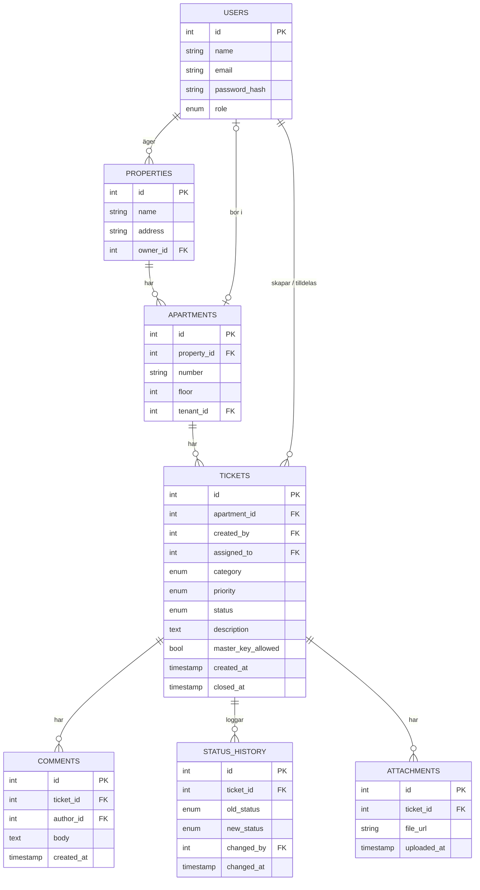

Förstahandsval Projektförslag · Producera och leverera mjukvara

# Felanmälan

Ett system där hyresgäster anmäler fel i lägenheten, förvaltaren fördelar ärendet och teknikern åtgärdar det. Alla kan se status under hela vägen.

**3** personer **5** sprintar à 1 vecka React · Spring Boot · PostgreSQL **3** användarroller

Bakgrund

## Problemet och lösningen

### Så fungerar det ofta i dag

- Fel anmäls via telefon, mejl eller lappar i trapphuset.
- Ärenden glöms bort eller hamnar hos fel person.
- Hyresgästen vet inte om någon har sett anmälan.
- Förvaltaren saknar överblick över vad som är öppet och hur lång tid saker tar.

### Vad vi bygger

- Ett ställe där alla felanmälningar samlas.
- Varje ärende har en tydlig status och en historik.
- Rätt tekniker får rätt ärende.
- Hyresgästen följer sitt ärende utan att behöva ringa.

En av oss jobbar med support åt fastighetsägare och känner igen problemet från verkligheten. Det ger oss realistiska user stories och en trovärdig redovisning.

Användare

## Tre roller

Roll

### Hyresgäst

- Skapar felanmälan
- Väljer kategori och rum
- Anger om huvudnyckel får användas
- Följer status och skriver kommentarer

Roll

### Tekniker

- Ser sina tilldelade ärenden
- Ändrar status
- Skriver kommentarer till hyresgästen
- Markerar ärendet som åtgärdat

Roll

### Förvaltare

- Hanterar fastigheter, lägenheter och användare
- Tilldelar ärenden till tekniker
- Ser alla öppna ärenden
- Stänger ärenden

### Ärendets statusflöde

Ny*→*Tilldelad*→*Pågår*→*Väntar (material/hyresgäst)*→*Åtgärdad*→*Stängd

Kategorier: VVS, El, Vitvaror, Ventilation, Lås och dörrar, Övrigt. Prioritet: Akut (t.ex. vattenläcka), Hög, Normal, Låg.

Omfattning

## MVP och prioritering (MoSCoW)

### Måste MVP

- Inloggning med roller (Spring Security + JWT)
- CRUD för fastigheter och lägenheter
- Skapa felanmälan
- Lista "mina ärenden" per roll
- Tilldela tekniker
- Ändra status med historik

### Bör Sprint 4–5

- Kommentarer på ärenden
- Bilduppladdning
- Filter och sök
- Översikt för förvaltaren
- Deploy

### Kan Om tid finns

- E-postnotiser vid statusändring
- Prioritet med SLA (t.ex. akut inom 4 h)
- Statistik: snittid till åtgärd
- CI/CD med GitHub Actions

### Inte nu (Won't)

- Mobilapp (webbappen ska i stället fungera i mobilbredd)
- SMS-notiser
- Chatt i realtid mellan hyresgäst och tekniker
- Tidsbokning av besök i en kalender
- Fakturering av reparationer
- Integration med befintliga fastighetssystem

Backlog

## Exempel på user stories

Med acceptanskriterier och estimering i klädstorlekar (S, M, L). Detta blir startpunkten för vår backlog i GitHub Projects.

Som hyresgäst vill jag skapa en felanmälan så att felet i min lägenhet blir åtgärdat.

Storlek: M

- **Givet** att jag är inloggad **när** jag fyller i kategori och beskrivning **då** skapas ärendet med status "Ny".
- Ärendet syns direkt i listan "Mina ärenden".
- Saknas beskrivning visas ett tydligt felmeddelande och inget sparas.

Som förvaltare vill jag tilldela ett ärende till en tekniker så att rätt person tar hand om det.

Storlek: M

- Bara användare med rollen förvaltare kan tilldela.
- Status ändras automatiskt till "Tilldelad".
- Ärendet syns i teknikerns lista.

Som tekniker vill jag ändra status på ett ärende så att hyresgästen vet hur det går.

Storlek: M

- Varje ändring sparas i historiken med tid och vem som ändrade.
- Teknikern kan bara ändra ärenden som är tilldelade till hen.
- Hyresgästen ser den nya statusen när sidan laddas om.

Som hyresgäst vill jag ange om huvudnyckel får användas så att teknikern kan komma in när jag inte är hemma.

Storlek: S

- Valet Ja/Nej är obligatoriskt när ärendet skapas.
- Valet syns tydligt för teknikern på ärendet.

Data

## Databasschema (första utkast)

`status_history` gör att vi kan visa hela ärendets tidslinje och räkna ut hur lång tid åtgärder tar. `attachments` är en "Bör"-funktion och kan läggas till senare.

Plan

## Sprintplan

Vecka 1–2\
Sprint 0

### Uppstart

Gruppkontrakt, Definition of Done, MVP och databasschema. Repo med skyddad `main`, board i GitHub Projects, grundstruktur för Spring Boot + React + PostgreSQL (docker-compose).

Vecka 3\
Sprint 1

### Inloggning och grunddata

Registrering/inloggning med roller. CRUD för fastigheter och lägenheter.

**Review-demo:** logga in som alla tre roller och se olika vyer.

Vecka 4\
Sprint 2

### Skapa ärenden

Formulär för felanmälan, lista "Mina ärenden", detaljvy.

**Review-demo:** en hyresgäst anmäler en droppande kran.

Vecka 5\
Sprint 3

### Hela flödet

Tilldelning, statusändringar och historik.

**Review-demo:** ärendet går från "Ny" till "Åtgärdad".

Vecka 6\
Sprint 4

### Kommunikation

Kommentarer, bilduppladdning, filter och sök.

**Review-demo:** hyresgäst bifogar bild, tekniker svarar.

Vecka 7\
Sprint 5

### Översikt och kvalitet

Översikt för förvaltaren, tester, buggfixar och deploy.

**Review-demo:** hela systemet live.

Vecka 8

### Leverans

Sista review, projektinlämning och muntlig redovisning.

Team

## Arbetsfördelning

Person A

### Användare och säkerhet

- Auth, roller och behörigheter
- Fastigheter och lägenheter

Person B

### Ärenden (API)

- Ärenden, status och historik
- Kommentarer och bilder

Person C

### Frontend och UX

- React-vyer per roll
- Formulär, listor och översikt

- Fokusområdena är startpunkter, inte murar. Varje sprint tar alla minst en story i det andra lagret (frontend/backend), så att alla kan förklara hela koden.
- Scrum master roterar varje vecka.
- Varje pull request granskas av minst en annan person innan merge.

Risker

## Risker och hur vi hanterar dem

| Risk | Åtgärd |
| --- | --- |
| Scope växer | Håll MoSCoW-listan strikt. Nya idéer hamnar i backlogen, inte i pågående sprint. |
| Auth tar för lång tid | Använd Spring Security + JWT enligt en beprövad guide och timeboxa till sprint 1. |
| Merge-konflikter | Små PR:er, en feature-branch per story, uppdatera från `main` dagligen. |
| Bilduppladdning krånglar | Spara filer lokalt först, molnlagring bara om tid finns. |

Kursen

## Varför den passar kursen

- **User stories och acceptanskriterier:** tre roller ger många naturliga stories med tydliga kriterier.
- **MVP och estimering:** MoSCoW-listan gör det lätt att visa vad som är MVP och vad som kan vänta.
- **Git i team:** tydliga moduler gör att vi kan jobba parallellt med branches och PR:er utan att krocka hela tiden.
- **Något att visa varje vecka:** varje sprint ger en konkret demo till review.
- **Beslutslogg (för VG):** naturliga beslut att motivera, t.ex. JWT vs sessioner, PostgreSQL, hur behörigheter kontrolleras.

Redovisning

## Så presenterar vi den

> "Felanmälan samlar alla fel i en fastighet på ett ställe. Hyresgästen anmäler, förvaltaren fördelar, teknikern åtgärdar, och alla ser status hela vägen."

1. Hyresgästen anmäler en droppande kran och tillåter huvudnyckel.
2. Förvaltaren ser ärendet och tilldelar en tekniker.
3. Teknikern sätter "Pågår" och sedan "Åtgärdad".
4. Hyresgästen ser hela historiken på sitt ärende.

Projektförslag för kursen Producera och leverera mjukvara. Ett av tre förslag: Felanmälan, Tvättstugebokning och Utrustningsförrådet.